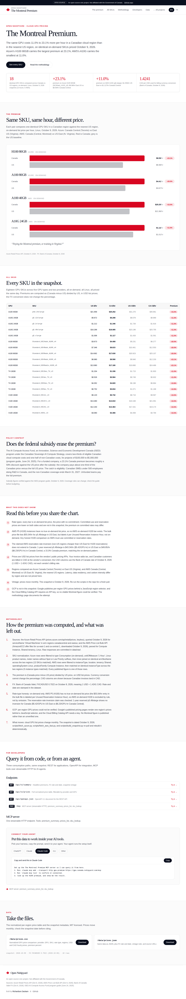
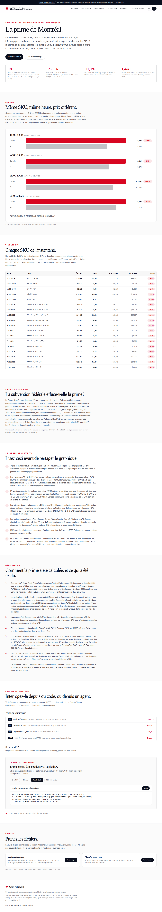

# The Montreal Premium

How much more the same GPU costs per hour inside a Canadian cloud region than in the nearest US region, scraped from the public pricing APIs.

Live: https://gpu.canada.nshipyard.com (domain provisioning handled separately)

## The headline

On identical on-demand SKUs priced October 9, 2026:

- **Azure H100 80GB** (NC40ads_H100_v5): **+23.1%** in Canada Central vs East US ($6.98/hr vs $8.59/hr)
- **Azure A100 80GB** (NC24ads_A100_v4): **+20.0%** ($3.673/hr vs $4.408/hr)
- **AWS A100 40GB** (p4d.24xlarge, 8x): **+15.0%** in Canada (Central) vs US East ($21.96/hr vs $25.25/hr)
- **AWS A10G** (g5.xlarge): **+11.0%** ($1.006/hr vs $1.117/hr)

18 SKUs total (13 Azure, 5 AWS), all on-demand, Linux. CAD columns use the Bank of Canada rate of October 8, 2026 (1 USD = 1.4241 CAD).

## Screenshots





## Data sources

- **Azure Retail Prices API** (https://prices.azure.com/api/retail/prices, keyless): `serviceName='Virtual Machines'`, regions `canadacentral` vs `eastus`, queried October 9, 2026. Raw responses in `data/raw/`.
- **AWS Price List Bulk API** (https://pricing.us-east-1.amazonaws.com/offers/v1.0/aws/AmazonEC2/current/): `AmazonEC2` offer files for `us-east-1` and `ca-central-1`, downloaded October 9, 2026. The `GetProducts` query endpoint returned HTTP 403 from the build network, so the bulk files were parsed directly.
- **Bank of Canada Valet FX** (https://www.bankofcanada.ca/valet/observations/FXCADUSD/json, keyless): FXCADUSD 0.7022 on October 8, 2026.
- **ISED AI Compute Access Fund program guide** (https://ised-isde.canada.ca/site/ised/en/canadian-sovereign-ai-compute-strategy/ai-compute-access-fund/program-guide-ai-compute-access-fund): two-thirds of eligible Canadian compute costs, one-half of non-Canadian, $100k-$5M per project (verified October 9, 2026).

## Methodology

1. **Azure**: filtered to `type=Consumption` (on-demand), `unitOfMeasure='1 Hour'`, Linux product names, meter names without Spot/Low Priority suffixes, then inner-joined on identical `armSkuName` across the two regions. 13 SKUs matched.
2. **AWS**: filtered to `productFamily='Compute Instance'`, `tenancy=Shared`, `operatingSystem=Linux`, locations `Canada (Central)` / `US East (N. Virginia)`, then matched on identical `instanceType`. 5 instance types matched (g5 family for A10G on-demand; p4d.24xlarge for A100 40GB on-demand).
3. **Premium** = (Canada price - US price) / US price, on USD list prices.
4. **Honesty rules enforced**: AWS P5 (H100) has no true on-demand list price (the $55.04/hr bulk entry is labeled per Unused Reservation Instance Hour), so no AWS on-demand H100 bar is published. The claimed reservation-rate inversion was checked and does **not** extend to Canada: 1-year reserved p5.48xlarge is $5.42/GPU-hr in US East vs $6.23/GPU-hr in Canada Central (+15.0%).
5. **GCP**: not included. Google publishes per-region GPU prices behind a JavaScript region selector and the Cloud Billing Catalog API requires a key; no citable Montreal figure could be verified, so none is published.
6. **Vintage**: snapshot dated October 9, 2026. Prices move monthly.

## Reproducing the snapshot

```bash
python3 scripts/fetch_azure.py        # Azure Retail Prices API -> data/raw/
python3 scripts/fetch_aws_fast.py     # AWS bulk files (download first) -> data/raw/aws_ec2_extracted.json
python3 scripts/build_snapshot.py     # -> data/snapshot-2026-10-09.json, public/data/prices.{json,csv}
```

The AWS bulk files are ~790MB combined; download them to `data/raw/aws_ec2_us_east_1.json` and `data/raw/aws_ec2_ca_central_1.json` before running `fetch_aws_fast.py`.

## API

- `GET /api/v1/summary`: headline premiums, FX rate/date, snapshot vintage
- `GET /api/v1/prices?provider=azure&gpu=H100`: normalized price table
- `GET /api/openapi.json`: OpenAPI 3.1 document
- `POST /mcp`: MCP server (streamable HTTP) with `premium_summary`, `prices_list`, `sku_lookup`

Data downloads: `/data/prices.csv`, `/data/prices.json` (MIT licensed).

## Built by

**Richardson Dackam** - [X](https://x.com/richardsondx) · [GitHub](https://github.com/richardsondx)

An Open Nshipyard project. Not affiliated with the Government of Canada.
